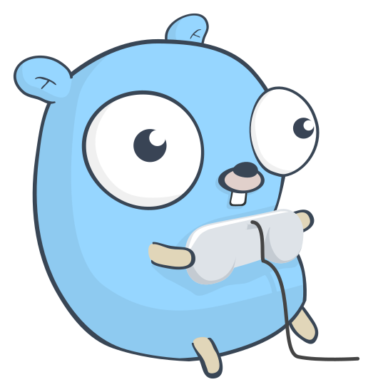

<p align="center">
  
</p>

# ebiten-template

🐹 [Ebiten/Ebitengine](https://ebitengine.org/) template for making 2D games with Go.

Play in your browser:

- [remarkablegames](https://remarkablegames.org/ebiten-template/)

Or download for desktop:

- [Windows](https://github.com/remarkablegames/ebiten-template/releases/latest/download/windows.zip)
- [macOS](https://github.com/remarkablegames/ebiten-template/releases/latest/download/macos.zip)
- [Linux](https://github.com/remarkablegames/ebiten-template/releases/latest/download/linux.zip)

## Credits

### Art

- [Gophers](https://github.com/egonelbre/gophers) by [Egon Elbre](https://github.com/egonelbre)

## Prerequisites

Install [Go](https://go.dev/doc/install):

```sh
brew install go
```

## Install

Clone the repository:

```sh
git clone https://github.com/remarkablegames/ebiten-template.git
cd ebiten-template
```

Install the [git hooks](lefthook.yml) with [lefthook](https://lefthook.dev/):

```sh
go tool lefthook install
```

Rename the game:

```sh
git grep -l ebiten-template | xargs sed -i '' -e 's/ebiten-template/my-game/g'
```

Update the files:

- [ ] `README.md`
- [ ] [`assets/icons/icon.icns`](https://remarkablemark.org/ico-icns-generator/)
- [ ] [`assets/icons/icon.ico`](https://remarkablemark.org/ico-icns-generator/)
- [ ] `assets/icons/logo.svg`
- [ ] `symbols/`
- [ ] `web/index.html`
- [ ] `web/manifest.webmanifest`

## Scripts

### Run

Open the game with hot reload:

```sh
go run .
```

### Format

Format the code:

```sh
gofmt -w .
```

### Lint

Lint the code:

```sh
go tool golangci-lint run
```

### Test

Run the tests:

```sh
go test ./...
```

## Development

### Assets

The sprite sheet and its metadata live in [`assets/sprites/`](assets/sprites) and the sound effects live in [`assets/sounds/`](assets/sounds). Both are compiled on build with `go:embed` by the [`assets`](assets) package.

### Hot Reload

On desktop, the game reloads on save. Edit a file in [`game/`](game) and watch the window update.

- Go files in `game/` (except tests) are loaded as one script.
- Reloads trigger automatically when a file in `game/` changes.
- If the script fails to compile, an error is shown on screen.
- Note that a reload re-evaluates the script, so the game state resets.

The script can import any package exposed in [`symbols/`](symbols). To expose another package, add a `go:generate` directive in [`symbols/symbols.go`](symbols/symbols.go) and regenerate:

```sh
go generate ./symbols
```

## Build

### Desktop

Build a native binary for production:

```sh
go build -tags release .
```

### Web

Build the web game:

```sh
env GOOS=js GOARCH=wasm go build -o web/ebiten-template.wasm .
cp "$(go env GOROOT)/lib/wasm/wasm_exec.js" web/
```

Serve the `web` directory with a static server:

```sh
python3 -m http.server -d web
```

Then open http://localhost:8000/ in your browser:

```sh
open http://localhost:8000/
```

Alternatively, use [wasmserve](https://github.com/hajimehoshi/wasmserve):

```sh
go run github.com/hajimehoshi/wasmserve@latest .
```

## License

[MIT](LICENSE)
